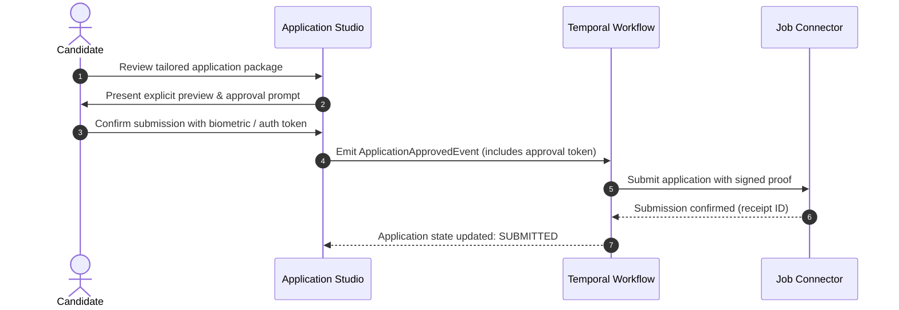

# Skill: Rolevia Multi-Tenant Security & Safety Protocol

## 1. Mission & Non-Negotiables

Rolevia holds sensitive career data: unredacted resumes, salary expectations, identity documents, and private employer histories. Cross-tenant leakage or credential compromise is unacceptable.

### The Five Inviolable Security Laws

1. **Zero Trust for Client-Supplied Scopes**: Never trust `tenantId` or `workspaceId` provided in URL query parameters or request bodies. Tenant context must be derived strictly from the authenticated, cryptographically validated JWT session.
2. **Double-Layered Isolation**: Application-layer checks must be reinforced by kernel-level database **Row-Level Security (RLS)** in PostgreSQL.
3. **Strict Human-in-the-Loop (HITL)**: Consequential operations (submitting external job applications, sending emails, deleting data) require explicit authenticated user policy and approval tokens.
4. **Secretless Codebase**: No credentials, private keys, JWT secrets, or connection strings in code or version control. Enforced by pre-commit guards and CI gitleaks.
5. **PII Masking by Default**: Candidate PII (phone numbers, street addresses, passwords, tokens) must never appear in application logs, error messages, or distributed traces.

---

## 2. Multi-Tenant Row-Level Security (RLS) Pattern

Every database query or transaction in PostgreSQL must set the local transaction variables before accessing tenant data.

### PostgreSQL RLS Policy Definition

```sql
-- Enable RLS on the table
ALTER TABLE candidate_vault_documents ENABLE ROW LEVEL SECURITY;

-- Enforce strict tenant isolation policy
CREATE POLICY tenant_isolation_policy ON candidate_vault_documents
    FOR ALL
    USING (
        tenant_id = NULLIF(current_setting('app.current_tenant_id', true), '')::uuid
        AND
        workspace_id = NULLIF(current_setting('app.current_workspace_id', true), '')::uuid
    );
```

### Application Context Wrapper (NestJS / Transaction Guard)

```typescript
import { Injectable } from "@nestjs/common";
import { Pool, PoolClient } from "pg";

export interface TenantContext {
  tenantId: string;
  workspaceId: string;
  userId: string;
}

@Injectable()
export class TenantTransactionRunner {
  constructor(private readonly pool: Pool) {}

  async runInTenantScope<T>(
    ctx: TenantContext,
    operation: (client: PoolClient) => Promise<T>,
  ): Promise<T> {
    const client = await this.pool.connect();
    try {
      await client.query("BEGIN;");

      // Set RLS variables scoped strictly to this transaction
      await client.query(
        "SELECT set_config('app.current_tenant_id', $1, true), set_config('app.current_workspace_id', $2, true), set_config('app.current_user_id', $3, true);",
        [ctx.tenantId, ctx.workspaceId, ctx.userId],
      );

      const result = await operation(client);
      await client.query("COMMIT;");
      return result;
    } catch (error) {
      await client.query("ROLLBACK;");
      throw error;
    } finally {
      client.release();
    }
  }
}
```

---

## 3. Ephemeral Cache & Vector Scoping

Every cache key in Redis and every vector search in `pgvector` must be scoped by `tenant_id` and `workspace_id`.

```typescript
// 1. Redis Cache Key Format
export function formatTenantCacheKey(
  tenantId: string,
  workspaceId: string,
  resourceKey: string,
): string {
  return `tenant:${tenantId}:workspace:${workspaceId}:${resourceKey}`;
}

// 2. pgvector Semantic Search Filter
export const VectorSearchFilter = (tenantId: string, workspaceId: string) => ({
  filter: {
    tenant_id: { $eq: tenantId },
    workspace_id: { $eq: workspaceId },
  },
});
```

---

## 4. Human-in-the-Loop (HITL) Consequential Action Gates

Any operation that affects the real world outside Rolevia (e.g. submitting a job application, sending an email to a recruiter) requires explicit user approval backed by a signed approval token.



---

## 5. PII Redaction & Safe Logging

All loggers must wrap outputs with an automatic PII and credential sanitizer:

```typescript
const SENSITIVE_KEYS = new Set([
  "password",
  "token",
  "secret",
  "authorization",
  "apiKey",
  "ssn",
  "phoneNumber",
  "address",
  "cookie",
]);

export function sanitizeLogData(
  obj: Record<string, unknown>,
): Record<string, unknown> {
  const sanitized: Record<string, unknown> = {};
  for (const [key, value] of Object.entries(obj)) {
    if (SENSITIVE_KEYS.has(key.toLowerCase())) {
      sanitized[key] = "[REDACTED]";
    } else if (typeof value === "object" && value !== null) {
      sanitized[key] = sanitizeLogData(value as Record<string, unknown>);
    } else {
      sanitized[key] = value;
    }
  }
  return sanitized;
}
```

---

## 6. Pre-Flight Verification Checklist

Before merging any backend, database, or API change:

- [ ] All database queries enforce Row-Level Security (`app.current_tenant_id`).
- [ ] No client-supplied tenant or workspace ID is trusted without JWT validation.
- [ ] Redis cache keys and locks include tenant & workspace prefixes.
- [ ] `pgvector` queries include mandatory `tenant_id` and `workspace_id` filters.
- [ ] Consequential actions verify human approval tokens.
- [ ] `pnpm verify:secrets` passes locally with zero detected credentials.
- [ ] Zero unredacted PII or auth headers in logs.
- [ ] External URLs in job connectors are checked against domain allowlists (SSRF defense).
