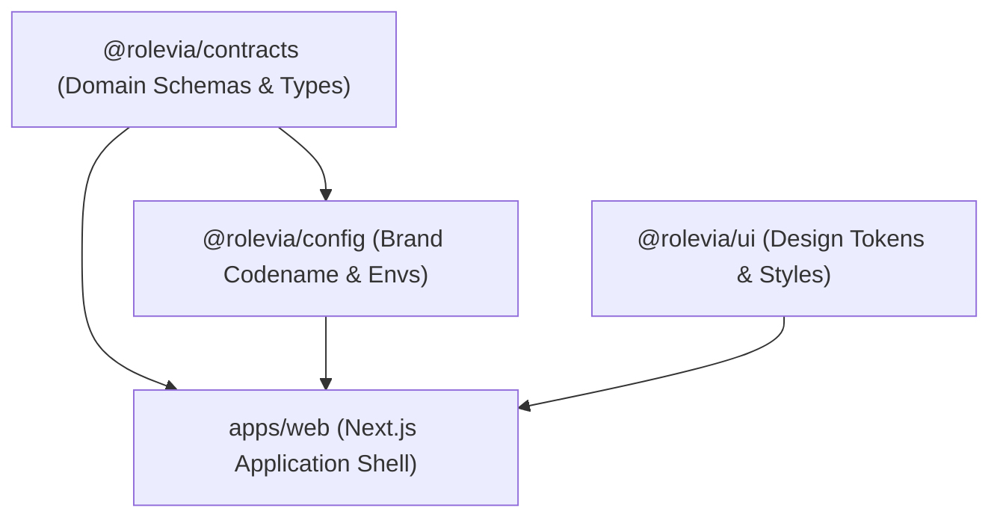

# Monorepo Dependency Map — Rolevia

---

## Dependency Invariants

- Packages may depend on `@rolevia/contracts` and `@rolevia/config`.
- `@rolevia/contracts` has zero internal workspace dependencies.
- Applications (`apps/*`) compose packages; packages never import from applications.
