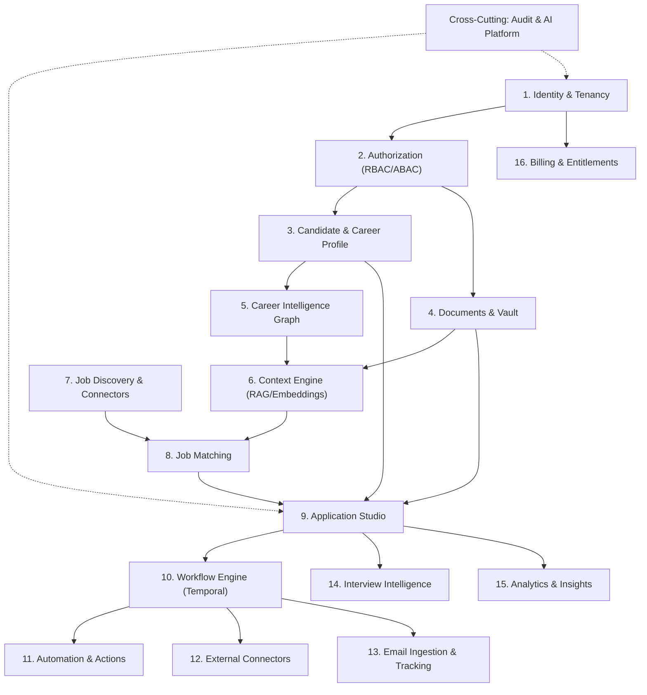

# Bounded Contexts

To prevent circular domain coupling and monolithic entanglement, Rolevia defines strict domain boundaries.

---

## Bounded Context Directory

---

## Context Definitions

1. **Identity & Tenancy**: Tenant accounts, workspaces, user memberships, and user sessions.
2. **Authorization**: RBAC and ABAC policy evaluation and role scoping.
3. **Candidate**: The core persona record, contact preferences, and career history.
4. **Documents**: Uploaded raw resumes, transcripts, portfolio links, and cryptographic hashes.
5. **Career Intelligence**: The normalized Career Graph (verified skills, experiences, projects, quantified metrics, and source evidence).
6. **Context Engine**: Chunking, vector embedding storage, hybrid search, context ranking, and tenant-scoped retrieval.
7. **Job Discovery**: Ingestion and normalization of job listings from supported sources.
8. **Job Matching**: Fit evaluation, requirement breakdown, missing skills detection, and match score computation.
9. **Applications**: Application packages, tailored resume versions, cover letters, and application state transitions.
10. **Workflow Engine**: Durable orchestration (Temporal) for long-running processes (retries, timeouts, human approval gates).
11. **Automation**: Rule execution, scheduled runs, and emergency stop controls.
12. **Connectors**: Adapters for third-party job boards, ATS portals, and integration endpoints.
13. **Email**: Ingestion of application receipt emails, interview invitations, and status tracking.
14. **Interview Intelligence**: Technical & behavioral prep, mock interviews, and company context packs.
15. **Analytics**: Funnel metrics, application response rates, and cost telemetry.
16. **Billing & Entitlements**: Subscription tiers, feature limits, usage metering, and provider abstraction.
17. **AI Platform**: LLM / embedding provider abstraction, prompt management, structured outputs, token tracking, and safety filters.

---

## Architectural Coupling Rules

- **No Direct Foreign Context Mutation**: A context may only modify entities it owns. Cross-context mutations must emit asynchronous events or call domain services through explicitly defined contracts.
- **Database Independence**: No service queries another context's internal tables directly. All interactions occur via published contracts (`packages/contracts`) or domain service interfaces.
