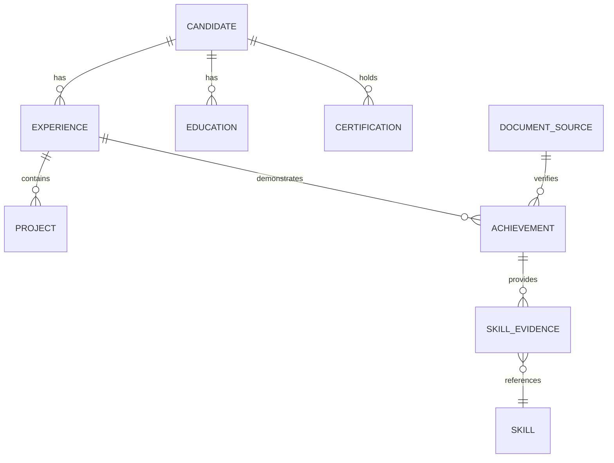

# Career Knowledge Graph

The Career Graph represents a candidate's structured, verified professional history.

---

## Entity-Relationship Topology

---

## Ground Truth Invariants

1. **User Verification Flag**: Each graph node contains an audit attribute:
   - `INFERRED_BY_AI`: Extracted automatically from documents without explicit candidate confirmation.
   - `CONFIRMED_BY_USER`: Explicitly reviewed, edited, or validated by the candidate.
2. **Fabrication Prohibition**: The graph strictly rejects the creation of skills, degrees, or company experiences that lack direct source document provenance or user affirmation.
