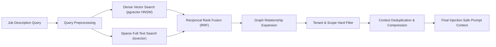

# Context Engine Architecture

The Context Engine manages candidate career intelligence retrieval and prompt context assembly using hybrid search and the Career Knowledge Graph.

---

## Retrieval Pipeline

---

## Core Tenets

1. **Tenant-Filtered Retrieval**: Vector index queries must enforce an immutable metadata filter (`tenant_id = :tenantId AND workspace_id = :workspaceId`). No embedding similarity calculation crosses workspace boundaries.
2. **Provenance Tracking**: Every retrieved chunk retains its source document ID, section, and user confirmation status.
3. **Context Compression**: High-value quantified bullet points take priority over boilerplate narratives to maximize prompt token efficiency.
