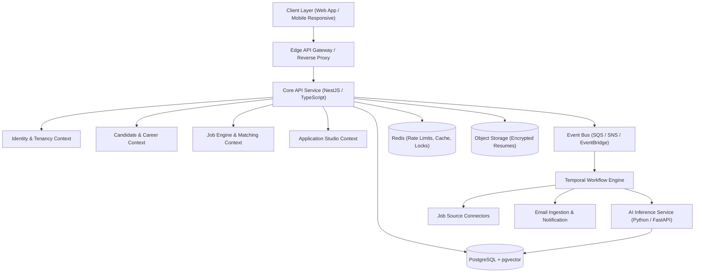

# System Overview

Rolevia is an AI Career Operating System designed as an event-driven, multi-tenant software platform. It bridges personal career management, market intelligence, resume preparation, workflow orchestration, and verified interview prep.

---

## High-Level Topology

---

## Architectural Guardrails

1. **Separation of Ephemeral and Authoritative State**: Redis holds ephemeral state (rate limiting, distributed locks, transient sessions). PostgreSQL is the authoritative single source of truth for all business and tenant entities.
2. **Provider Independence**: Core domain aggregates do not invoke specific AI APIs or external portal scrapers directly. Provider adapters isolate external protocols behind domain interfaces.
3. **No Unsanitized Third-Party Instructions**: Text retrieved from job descriptions, resume PDFs, or scraped portals is labeled `UNTRUSTED_EXTERNAL_DATA` and stripped of instruction execution privileges.
