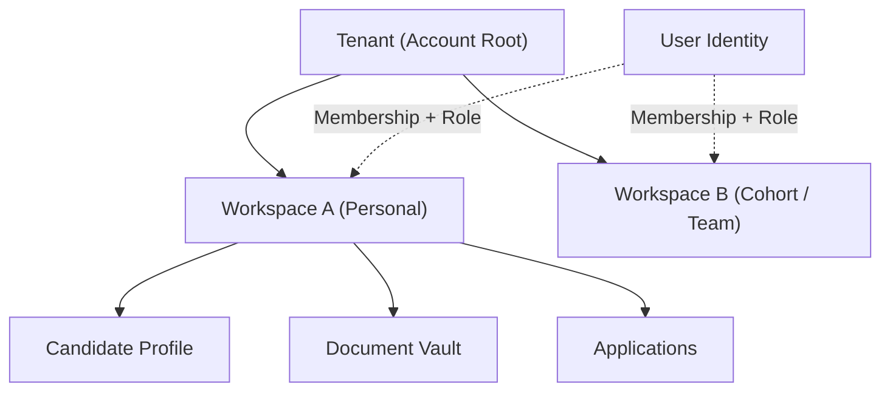

# Multi-Tenancy Architecture

Multi-tenancy is enforced from Phase 0 as a foundational security requirement.

---

## Tenancy Model

Rolevia employs a logical multi-tenant model:

- **Tenant**: The root boundary (e.g. Individual Candidate Account, or Enterprise Organization).
- **Workspace**: A localized partition within a Tenant (e.g., Default personal workspace, Cohort workspace in an organization).
- **User**: An authenticated human identity holding memberships in one or more Workspaces with designated roles.



---

## Strict Isolation Invariants

1. **Untrusted Client Inputs**:
   Never trust a `tenantId` or `workspaceId` supplied in client HTTP headers or URL parameters without evaluating the authenticated session's cryptographic claims and verified workspace membership.
2. **Database Query Scoping**:
   All database tables storing tenant data must include a non-nullable `tenant_id UUID` and `workspace_id UUID`. All queries must explicitly filter on both identifiers. Row-Level Security (RLS) in PostgreSQL provides defense-in-depth.
3. **Vector Store Isolation**:
   pgvector queries must include an indexed metadata filter `WHERE tenant_id = :tenantId AND workspace_id = :workspaceId`. No vector search executes globally across the vector space.
4. **Cache Key Scoping**:
   Redis keys must follow the canonical namespace:
   ```text
   tenant:{tenantId}:workspace:{workspaceId}:{entity}:{id}
   ```
5. **Object Storage Isolation**:
   S3 / Storage bucket objects must follow tenant prefix partitions:
   ```text
   tenants/{tenantId}/workspaces/{workspaceId}/documents/{documentId}/{filename}
   ```
   Direct object access requires short-lived pre-signed URLs verified against user workspace entitlements.
