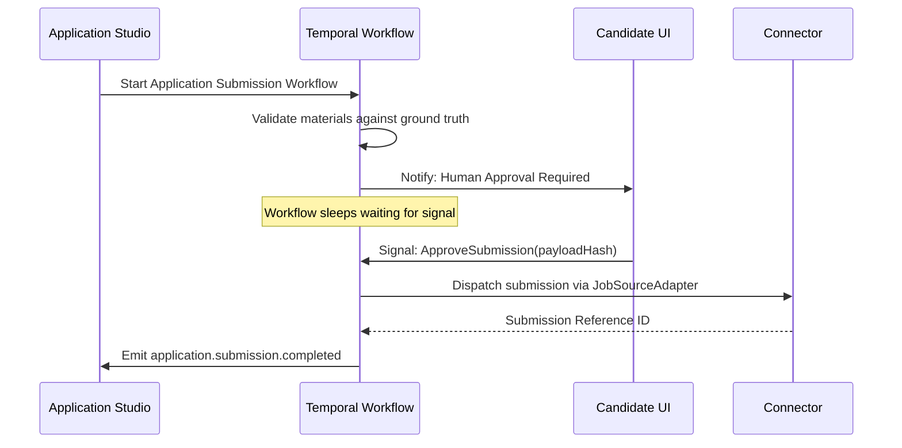

# Workflow Engine Architecture

Long-running, asynchronous, or multi-step operations in Rolevia are orchestrated via the **Temporal Workflow Engine**.

---

## Core Workflow Domains

1. **Document Ingestion Workflow**: Upload → Antivirus Scan → Text Extraction → Schema Parsing → Career Graph Ingestion → pgvector Embedding.
2. **Application Tailoring Workflow**: Job Requirement Extraction → Fit Evaluation → Career Evidence Retrieval → Resume Customization → Truth Verification → Package Assembly.
3. **Application Submission Workflow**: Verification Check → Human Approval Gate → Connector Pre-flight → Submission Execution → Outcome Verification.

---

## Human Approval Gate Pattern

Consequential actions pause execution until human consent is provided:

---

## Invariants

- **Determinism**: Workflow logic must remain deterministic. All network I/O, AI calls, and database updates occur exclusively within Temporal Activities.
- **Idempotency**: Every activity requires an idempotency key derived from `workflowId + activityName + entityVersion`.
- **Compensation**: If a multi-step operation fails midway (e.g. storage error after external call), compensating rollback activities are triggered to return the aggregate to a clean state.
